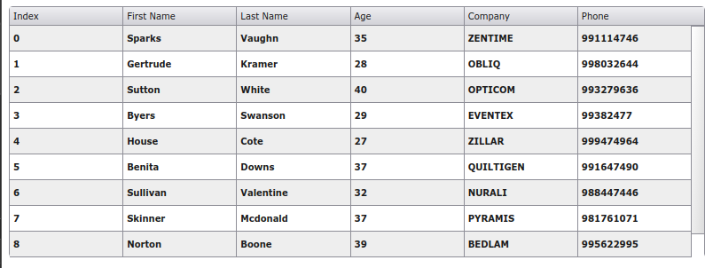
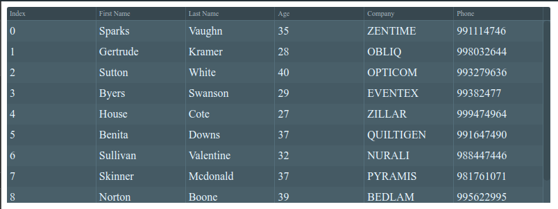
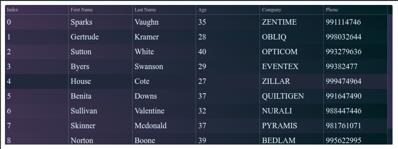
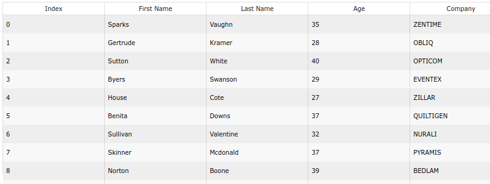

# xGridV2

Grid de dados em JavaScript puro, sem dependências de runtime. Escrito em TypeScript e distribuído pelo npm como [`xgridv2`](https://www.npmjs.com/package/xgridv2).

- Carrega os dados de um array de objetos (JSON).
- Ordena ao clicar no título da coluna e redimensiona colunas arrastando a borda do título.
- Filtra por texto ou por campo, sempre sobre a lista completa.
- Pagina por rolagem (scroll infinito) com consulta ao servidor.
- Liga as colunas a um formulário (`sideBySide`), com botões de incluir, alterar, salvar e cancelar.
- Soma valores de uma coluna, imprime a lista e navega pelo teclado.
- Escapa o HTML das células por padrão (proteção contra XSS).
- Oito temas, entre eles o `x-Vyzo`, que segue as cores da página.

## Instalação

```sh
npm install xgridv2
```

## Uso

### Com bundler (Vite, Vue, webpack…)

```typescript
import xGridV2 from 'xgridv2'
import type { ixGrid, ixGridCreate } from 'xgridv2'
import 'xgridv2/index.css'
```

Em um componente Vue, o CSS também pode entrar pelo `<style>`:

```css
@import "xgridv2/index.css";
```

```typescript
const grid: ixGridCreate = new xGridV2.create({
  el: '#pnGrid',
  columns: {
    Código: { dataField: 'id', width: '15%', center: true },
    Nome: { dataField: 'nome', width: '85%' },
  },
  dblClick: (linha) => abrir(linha.id),
})

grid.source([
  { id: 1, nome: 'Ana' },
  { id: 2, nome: 'Bruno' },
])
```

O elemento precisa existir antes do `create`. No Vue, crie o grid no `onMounted`:

```typescript
import { onMounted, reactive } from 'vue'

const fields = reactive({ title: '', authors: '' })
let grid: ixGridCreate

onMounted(() => {
  grid = new xGridV2.create({
    el: '#pnGrid',
    sideBySide: {
      el: '#form',
      vModel: fields, // recebe a linha selecionada
    },
  })
})
```

### Sem bundler (tag `<script>`)

O pacote também traz uma versão que cria a variável global `xGridV2`:

```html
<link rel="stylesheet" href="node_modules/xgridv2/xGridV2/index.css">
<script src="node_modules/xgridv2/xGridV2/xGridV2.js"></script>

<div id="pnGrid" style="height: 400px"></div>

<script>
  const grid = new xGridV2.create({ el: '#pnGrid' })
  grid.source(dados)
</script>
```

Os mesmos arquivos estão no unpkg: `https://unpkg.com/xgridv2/xGridV2/xGridV2.js` e `https://unpkg.com/xgridv2/xGridV2/index.css`.

### O que o pacote traz

| Caminho no import | Arquivo | Uso |
|---|---|---|
| `xgridv2` | `xGridV2/xGridV2.mjs` | Módulo ES (`import`) |
| `xgridv2/index.css` | `xGridV2/index.css` | Estilos e temas |
| `xgridv2/xGridV2.js` | `xGridV2/xGridV2.js` | Script com a global `xGridV2` |
| (tipos) | `xGridV2/index.d.ts` | Tipos TypeScript (`ixGrid`, `ixGridCreate`…) |

## Comportamento

- **Seleção de texto:** clique e arraste sobre as células para selecionar o texto e copie com Ctrl+C. O duplo clique não seleciona a palavra, para não atrapalhar o `dblClick`. Em campos editáveis dentro da grid, o duplo clique funciona normalmente.
- **Teclado:** as setas mudam a linha selecionada e o Enter chama `enter`. Veja também `onKeyDown`, `keySelectUp` e `keySelectDown`.
- **Filtro:** `filter()` sempre busca na lista completa que veio do `source`. Filtrar de novo troca o resultado, e `filter('')` mostra todas as linhas outra vez.
- **Ordenação:** clicar no título ordena pela coluna; clicar de novo inverte. Com um filtro ativo, a ordenação vale só para o resultado filtrado.
- **Sem resultado:** a grid mostra o texto de `xGridV2.setNotFound()` (padrão: "Nada Localizado").
- **Carregando:** `load()` usa as classes do Font Awesome 4 (`fa fa-spinner`) no ícone. Sem o Font Awesome na página, aparece só o texto.

## Segurança (XSS)

Por padrão (`escapeCells: true`), o conteúdo das células é escapado antes de ir para o DOM. Assim um dado vindo do servidor não executa HTML nem script.

A coluna que usa `compare` ou `render` para gerar HTML de propósito (uma imagem, por exemplo) precisa declarar `html: true`:

```javascript
columns: {
  Capa: { dataField: 'thumbnail', compare: 'thumbnail', html: true },
},
compare: {
  thumbnail: (r) => ``,
},
```

| Opção | Efeito | Padrão |
|---|---|---|
| `escapeCells` | Escapa o HTML de todas as células | `true` |
| `columns[].html` | Deixa a coluna renderizar HTML | `false` |
| `printHeadHtml` | Trata o parâmetro de `print(headHTML)` como HTML confiável | `false` |

`escapeCells: false` volta ao comportamento antigo, sem escape. O cabeçalho definido por `xGridV2.setPrintHead()` é sempre tratado como HTML confiável.

## Temas

| Classe | Aparência |
|---|---|
| `x-grayV2` | Cinza claro (padrão) |
| `x-darkV2` | Cinza-azulado escuro |
| `x-opacite` | Gradiente escuro, roxo e verde-petróleo |
| `x-whiteV2` | Branco |
| `x-blue` | Tons de azul |
| `x-bocatan` | Escuro azulado |
| `x-modern-dark` | Grafite escuro |
| `x-Vyzo` | Segue as cores da página, no modo claro ou escuro |

| x-grayV2 | x-darkV2 |
|---|---|
|  |  |

| x-opacite | x-whiteV2 |
|---|---|
|  |  |

Há três formas de escolher o tema:

```javascript
new xGridV2.create({ el: '#pnGrid', theme: 'x-darkV2' }) // só neste grid
xGridV2.setTheme('x-Vyzo')     // padrão dos grids criados daqui em diante
xGridV2.changeTheme('x-Vyzo')  // troca nos grids já criados e vira o padrão
```

### Cores do x-Vyzo

O `x-Vyzo` lê as variáveis CSS abaixo quando a página as define. Sem elas, usa os valores padrão. Com a classe `dark` em um elemento acima da grid (por exemplo `<html class="dark">`), usa os padrões do modo escuro.

| Variável | Uso | Padrão claro | Padrão escuro |
|---|---|---|---|
| `--matdash-bg-card` | Fundo | `#ffffff` | `#26343f` |
| `--matdash-text-primary` | Texto | `#2b2e30` | `#a9bac7` |
| `--matdash-text-secondary` | Títulos das colunas | `#6c757d` | `#a9bac7` |
| `--matdash-text-muted` | Aviso de "Nada Localizado" | `#adb5bd` | `#7c8c97` |
| `--matdash-border` | Bordas | `#e1eef4` | `#3a4a55` |
| `--v-theme-primary` | Destaque, no formato `r, g, b` (como no Vuetify) | `40, 136, 213` | `77, 163, 255` |

## Opções do `create`

```javascript
const grid = new xGridV2.create({ el: '#pnGrid', ...opções })
```

| Opção | Tipo | Padrão | Descrição |
|---|---|---|---|
| `el` | `string` ou `HTMLDivElement` | | Seletor ou elemento onde a grid é montada. **Obrigatório.** |
| `source` | `object[]` | `[]` | Dados iniciais. |
| `width` | `number` ou `string` | definido pelo CSS | Número vira px; string com `%` ou `px` é usada como está. |
| `height` | `number` ou `string` | `'100%'` | Mesma regra de `width`. |
| `heightLine` | `number` | definido pelo tema | Altura de cada linha, em px. |
| `setfocus` | `number` | | Linha que recebe o foco ao carregar, contando a partir de 1. |
| `theme` | `string` | `'x-grayV2'` | Classe do [tema](#temas). |
| `title` | `boolean` | `true` | `false` esconde a barra de títulos, e as linhas ocupam toda a altura. |
| `count` | `boolean` | `false` | Mostra a numeração das linhas na primeira coluna. |
| `multiSelect` | `boolean` | `false` | Com Ctrl pressionado, clicar em outras linhas mantém as anteriores marcadas. |
| `escapeCells` | `boolean` | `true` | Veja [Segurança](#segurança-xss). |
| `printHeadHtml` | `boolean` | `false` | Veja [Segurança](#segurança-xss). |
| `filterDelay` | `number` ou `false` | `false` | Espera, em ms, antes de executar `filter()`. Útil para filtrar enquanto a pessoa digita. |
| `columns` | `object` | todas as chaves dos dados | Veja [columns](#columns). |
| `compare` | `object` | | Veja [compare](#compare). |
| `filter` | `object` | | Veja [filter](#filter). |
| `query` | `object` | | Veja [query](#query-paginação). |
| `sideBySide` | `object` | | Veja [sideBySide](#sidebyside-formulário). |
| `onSelectLine` | `(linha) => void` | | Chamada quando uma linha é selecionada. |
| `click` | `(linha) => void` | | Chamada ao clicar em uma linha. |
| `dblClick` | `(linha) => void` | | Chamada no duplo clique em uma linha. |
| `enter` | `(linha, evento) => void` | | Chamada ao pressionar Enter em uma linha. |
| `onKeyDown` | `object` | | Veja [onKeyDown](#onkeydown). |
| `keySelectUp` | `number` ou `number[]` | | `keyCode` de teclas que, além da seta, sobem a seleção. |
| `keySelectDown` | `number` ou `number[]` | | `keyCode` de teclas que, além da seta, descem a seleção. |
| `complete` | `() => void` | | Chamada quando a grid termina de ser montada. |

### columns

Cada chave é o título da coluna. Sem `columns`, a grid mostra todas as chaves dos dados.

```javascript
columns: {
  Nome: { dataField: 'NOME', width: '70%' },
  Data: { dataField: 'DATA', width: '30%', center: true, render: formatDateBR },
}
```

| Propriedade | Tipo | Descrição |
|---|---|---|
| `dataField` | `string` | Chave do objeto de dados mostrada na coluna. |
| `width` | `string` | Largura, por exemplo `'15%'`. |
| `left` / `center` / `right` | `boolean` | Alinhamento do texto. |
| `class` | `string` | Classes aplicadas ao conteúdo da célula, separadas por espaço. |
| `style` | `string` | CSS aplicado ao conteúdo da célula, por exemplo `'color: red; font-size: 16px'`. |
| `render` | `(valor) => any` | Recebe o valor da célula e devolve o que será mostrado. |
| `compare` | `string` | Nome de uma função de [compare](#compare). |
| `html` | `boolean` | Permite HTML no resultado de `render`/`compare`. Padrão `false`. |

### compare

Funções reutilizáveis entre colunas. Cada função recebe a linha inteira, com uma propriedade extra `value` contendo o valor da coluna.

```javascript
new xGridV2.create({
  el: '#pnGrid',
  compare: {
    nomeCompleto: (r) => r.firstName + ' ' + r.lastName,
    invertido: (r) => r.value.split('').reverse().join(''),
  },
  columns: {
    Nome: { dataField: 'firstName', compare: 'nomeCompleto' },
  },
})
```

### onKeyDown

Funções disparadas por teclas pressionadas na grid. A chave do objeto é o `keyCode`, precedido dos modificadores nesta ordem: `ctrl+`, `shift+`, `alt+`. A função recebe a linha selecionada e o evento. Depois dela, a grid chama `preventDefault()` e `stopPropagation()` no evento.

```javascript
onKeyDown: {
  70: (linha, e) => alert('F pressionada'),
  'ctrl+13': (linha, e) => alert('Ctrl + Enter'),
  'ctrl+shift+46': (linha, e) => excluir(linha),
}
```

### filter

Regras usadas por `grid.filter()`.

```javascript
filter: {
  filterBegin: false,
  fields: ['NOME', 'CPF'],
  conditional: 'AND',
}
```

| Propriedade | Tipo | Padrão | Descrição |
|---|---|---|---|
| `filterBegin` | `boolean` | `false` | `true` exige que o texto apareça no começo do conteúdo. `false` aceita em qualquer posição. |
| `fields` | `string[]` | todas as colunas | Campos (`dataField`) onde a busca acontece. |
| `conditional` | `'OR'` ou `'AND'` | `'OR'` | Com um texto de várias palavras, `OR` aceita a linha que tiver qualquer uma delas, e `AND` exige todas. Com um objeto, vale o mesmo para os campos. |

A busca não diferencia maiúsculas de minúsculas.

### query (paginação)

Busca os dados aos poucos, conforme a pessoa rola a lista.

```javascript
const grid = new xGridV2.create({
  el: '#pnGrid',
  query: {
    endScroll: 0.1,
    execute: async ({ offset, page, param }) => {
      const r = await fetch(`/api/livros?q=${param.desc}&offset=${offset}&limit=${param.limite}`)
      grid.querySourceAdd(await r.json())
    },
  },
})

grid.queryOpen({ desc: 'sherlock', limite: 20 })
```

| Propriedade | Tipo | Padrão | Descrição |
|---|---|---|---|
| `endScroll` | `number` | `0.1` | Fração final da rolagem que dispara a próxima consulta (0.1 = faltando 10%). |
| `execute` | `({ offset, page, param }) => void` | | Busca a próxima página. `offset` é o número de linhas já carregadas, `page` começa em 1 e `param` é o objeto passado a `queryOpen`. |

- Comece a busca com `queryOpen(param)`, que reinicia a paginação e chama `execute` para a primeira página. As linhas dessa página substituem as que estavam na grid.
- Dentro de `execute`, entregue as linhas com `querySourceAdd(linhas)`.
- Quando não houver mais registros, chame `querySourceAdd([])`. A grid para de consultar ao rolar.

### sideBySide (formulário)

Liga a linha selecionada a um formulário: ao selecionar uma linha, os campos recebem os valores dela.

```javascript
sideBySide: {
  el: '#form',
}
```

```html
<form id="form">
  <input name="nome">
  <input name="cpf">
</form>
```

A ligação é feita pelo atributo `name` dos campos (`input`, `select`, `textarea`), que precisa ser igual ao `dataField` da coluna. Um `vModel` objeto recebe os mesmos valores; com `vModel` função, a ligação por `name` não acontece.

| Propriedade | Tipo | Descrição |
|---|---|---|
| `el` | `string` | Seletor do formulário ou da div com os campos. **Obrigatório.** |
| `vModel` | `object` ou `(linha) => void` | Objeto reativo (Vue 3 `reactive()`) que recebe os valores da linha selecionada, ou uma função que recebe uma cópia da linha. |
| `vRefs` | `object` | Template refs do Vue usados por `focusField` e `disableFieldsSideBySide`, no formato `{ title: { $el: inputTitle } }`. |
| `render` | `object` | Por campo, função que transforma o valor antes de ir para o formulário: `{ preco: (v) => formatMoney(v) }`. |
| `compare` | `object` | Por campo, nome de uma função de [compare](#compare): `{ nome: 'nomeCompleto' }`. |
| `tabToEnter` | `boolean` | Padrão `true`: Enter passa para o próximo campo do formulário. |
| `frame` | `object` | Veja [frame](#frame-botões). |
| `duplicity` | `object` | Veja [duplicity](#duplicity). |

#### frame (botões)

Cria botões ligados ao formulário.

```javascript
sideBySide: {
  el: '#form',
  frame: {
    el: '#botoes',
    buttons: {
      incluir: { html: 'Incluir', state: xGridV2.state.insert, click: () => grid.focusField() },
      alterar: { html: 'Alterar', state: xGridV2.state.update, click: (linha) => {} },
      salvar: { html: 'Salvar', state: xGridV2.state.save, preLoad: 'Salvando…', click: salvar },
      cancelar: { html: 'Cancelar', state: xGridV2.state.cancel, click: () => {} },
    },
  },
}
```

| Propriedade | Tipo | Descrição |
|---|---|---|
| `el` | `string` | Seletor do elemento onde os botões são criados. **Obrigatório.** |
| `class` | `string` | Classes do elemento dos botões. |
| `style` | `string` | CSS do elemento dos botões. |
| `buttons` | `object` | Um objeto por botão, com as propriedades abaixo. |

| Propriedade do botão | Tipo | Descrição |
|---|---|---|
| `html` | `string` | Conteúdo do botão. |
| `state` | `string` | Papel do botão: `xGridV2.state.insert`, `update`, `delete`, `save`, `cancel` ou `select`. |
| `click` | `(linha, evento) => any` | Executada no clique. Pode ser `async`. Se devolver `false`, o modo do formulário não muda. |
| `preLoad` | `string` | HTML mostrado no botão enquanto o `click` executa. |
| `class`, `style`, `id` | `string` | Classes, CSS e id do botão. |

O formulário começa somente leitura, com Salvar e Cancelar desabilitados. Os botões `insert` e `update` entram no modo de edição: liberam os campos, habilitam Salvar e Cancelar e desabilitam os outros botões com `state`. Os botões `save` e `cancel` saem do modo de edição. Salvar e Excluir ficam desabilitados enquanto o `click` executa.

#### duplicity

Verifica, ao sair de um campo, se o valor digitado já existe em outro registro.

```javascript
sideBySide: {
  el: '#form',
  duplicity: {
    dataField: ['cpf'],
    execute: async ({ field, value, text }) => {
      const existe = await consultarCpf(value)
      if (existe) {
        grid.showMessageDuplicity(`O campo ${text} já está cadastrado`)
        grid.focusField(field)
        return true
      }
    },
  },
}
```

| Propriedade | Tipo | Descrição |
|---|---|---|
| `dataField` | `string[]` | Campos verificados. |
| `execute` | `({ field, value, text }) => any` | Executada quando o campo perde o foco com um valor diferente do registro e não vazio. `field` é o nome do campo, `value` o valor digitado e `text` o rótulo: o texto do elemento anterior ao campo, o `placeholder` ou o atributo `label`. |

## Métodos da instância

```javascript
grid.filter('ana')
```

### Dados

| Método | Descrição |
|---|---|
| `source(linhas)` | Substitui os dados da grid. |
| `sourceAdd(linhas)` | Acrescenta linhas ao final. |
| `data()` | Devolve as linhas da grid. Com um filtro ativo, só as filtradas. |
| `dataSource()` | Devolve a linha selecionada, ou `false` se nenhuma estiver selecionada. |
| `dataSource(campo)` | Devolve o valor do campo na linha selecionada. |
| `dataSource(campo, valor)` | Altera o valor do campo na linha selecionada e atualiza a célula. |
| `dataSource({ campo: valor, … })` | Altera vários campos da linha selecionada. |
| `insertLine(linha, ordem?, callback?)` | Insere uma ou mais linhas no fim (`'BOTTOM'`, padrão) ou no começo (`'TOP'`). |
| `deleteLine(índice?)` | Remove a linha do índice informado (a partir de 0) ou a selecionada, e devolve os dados dela. |
| `sumDataField(campo)` | Soma os valores do campo em todas as linhas. |
| `getColumns()` | Devolve a configuração das colunas. |
| `getCompare` | Propriedade (não é função) com as funções de `compare`. |

### Seleção e estado

| Método | Descrição |
|---|---|
| `focus(índice?)` | Foca a linha do índice, contando a partir de 0. Sem índice, foca a selecionada. |
| `getIndex()` | Índice da linha selecionada, a partir de 0. |
| `disable(callback?)` | Bloqueia a grid. |
| `enable(callback?)` | Desbloqueia a grid. |
| `clear(callback?)` | Limpa as linhas da tela. Os dados continuam em `data()`. |
| `load(texto?, callback?)` | Mostra o aviso de carregando (padrão "Carregando . . ."). |
| `closeLoad(callback?)` | Esconde o aviso de carregando. |
| `print(cabeçalho?)` | Imprime a grid. O cabeçalho é texto, ou HTML com `printHeadHtml: true`. Sem ele, usa o de `xGridV2.setPrintHead()`. |
| `setKeySelectUp(keyCodes)` | Troca as teclas de `keySelectUp`. |
| `setKeySelectDown(keyCodes)` | Troca as teclas de `keySelectDown`. |

### Filtro e paginação

| Método | Descrição |
|---|---|
| `filter(texto, callback?)` | Filtra pelo texto, seguindo as regras de [filter](#filter). O callback recebe o número de linhas encontradas. |
| `filter({ campo: valor }, callback?)` | Filtra pelos campos informados, por exemplo `grid.filter({ nome: 'Robert', sobrenome: 'Drummond' })`. |
| `setFilterBegin(boolean)` | Troca `filter.filterBegin`. |
| `setFilterConditional('OR' \| 'AND')` | Troca `filter.conditional`. |
| `queryOpen(param, callback?)` | Começa uma busca paginada. Veja [query](#query-paginação). |
| `querySourceAdd(linhas)` | Entrega as linhas buscadas pelo `execute`. Um array vazio encerra a paginação. |

### Formulário (sideBySide)

| Método | Descrição |
|---|---|
| `focusField(nome?)` | Foca e seleciona o campo. Sem nome, o primeiro campo editável. |
| `disableFieldsSideBySide(boolean)` | `true` deixa os campos somente leitura; `false` libera. |
| `disableBtnsSaveCancel(boolean)` | `true` entra no modo de edição (Salvar e Cancelar habilitados, campos liberados) e `false` sai dele. Os outros botões com `state` ficam no estado oposto. |
| `getElementSideBySideJson(maiúsculas?, ignorarVazios?)` | Devolve os valores dos campos como objeto. Números com vírgula viram número, datas `dd/mm/aaaa` viram `aaaa-mm-dd` e checkbox vira `'1'` ou `'0'`. Padrões: `false` e `true`. |
| `getDiffTwoJson(maiúsculas?, ignorarVazios?)` | Compara o formulário com a linha selecionada e devolve `{ old, new, diff }`, em que `diff` é `false` quando nada mudou. |
| `clearElementSideBySide()` | Limpa os campos do formulário. |
| `getDuplicityAll()` | Executa o `duplicity.execute` de todos os campos alterados. Devolve uma Promise com o primeiro retorno verdadeiro, ou `false`. |
| `showMessageDuplicity(texto, tempo?)` | Mostra um aviso por `tempo` ms (padrão 5000). |

## Funções globais

| Função | Descrição |
|---|---|
| `xGridV2.create` | Construtor da grid: `new xGridV2.create({ … })`. |
| `xGridV2.version` | Versão do pacote, por exemplo `"2.4.1"`. |
| `xGridV2.state` | Papéis dos botões de `frame`: `insert`, `update`, `delete`, `save`, `cancel`, `select`. |
| `xGridV2.setTheme(tema)` | Define o tema padrão dos próximos grids. |
| `xGridV2.changeTheme(tema)` | Troca o tema dos grids já criados e define o padrão. |
| `xGridV2.setNotFound(texto)` / `getNotFound()` | Texto mostrado quando não há linhas. |
| `xGridV2.setPrintHead(html)` / `getPrintHead()` | Cabeçalho padrão da impressão. |

## Desenvolvimento

```sh
git clone git@github.com:dffrancisco/xGridV2.git
cd xGridV2
npm install
```

| Comando | O que faz |
|---|---|
| `npm test` | Roda os testes (Vitest + jsdom). |
| `npm run typecheck` | Verifica os tipos. |
| `node scripts/build.js` | Gera a pasta `xGridV2/` sem mudar a versão. |
| `npm run dev` | Gera `xGridV2/` e refaz a cada alteração. |
| `npm run build` | Atalho para `npm version patch`. |
| `npm run serve` | Serve o projeto em `http://localhost:8080`. O exemplo fica em `/examples/index.html` e usa a pasta `xGridV2/` gerada. |

O código está em `index.ts` e os estilos em `index.css`. Os tipos públicos ficam em `index.d.ts`, escrito à mão: ao mudar uma opção ou método, atualize os dois arquivos. A pasta `xGridV2/` é gerada pelo build e vai para o npm.

### Publicar uma versão

1. `npm test` e `npm run typecheck`.
2. Commit das mudanças (o `npm version` exige o git limpo).
3. `npm version patch` (ou `minor` / `major`). Ele sobe a versão, gera a pasta `xGridV2/` já com o número novo e cria o commit e a tag com tudo junto.
4. `npm publish`. A conta usa autenticação em dois fatores: `npm publish --otp=<código>`.
5. `git push --follow-tags`.
6. Nos projetos que usam a grid: `npm install xgridv2@latest`.

As mudanças de cada versão estão no [CHANGELOG.md](./CHANGELOG.md).

## Licença

ISC. Desenvolvido por [Francisco Alves](https://github.com/dffrancisco).
